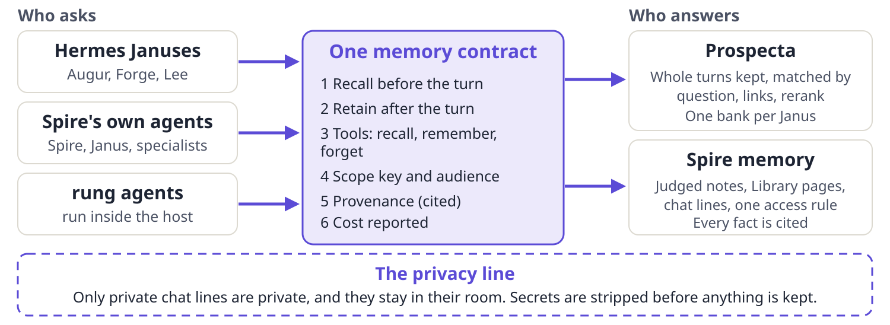

::: summary
### The short version

- **The same problem, solved three times.** Prospecta (behind Augur, Forge and Lee), Spire's memory and the Tencent system all answer one question: what is recalled before a turn, what is kept after it, which tools the agent gets, whose memory it is, where each fact came from, and what it cost. That bundle is the *agent memory contract*.
- **Share the contract, not the store.** One shared store would trade away what each side does best: Spire's access rules and audit trail, Prospecta's deep recall. Spire already serves a written contract (rung-memory/1) to agents in its host, and Prospecta can answer to the same one. Merging the stores is not worth the risk.
- **Tencent is a source of ideas, not a server to adopt.** One shared server for many agents is tidy and real, but its recall is shallower than Prospecta's, its public code has no unit tests, and its one benchmark cannot be reproduced. Several of its ideas are worth borrowing (section 7).
- **Smallest first step, no code:** one page that writes the contract down once and lists each system's gaps. If wanted, a scout then scores Prospecta and Spire behind the same contract on a generic question set.
- **The ask:** six questions at the end, each with a recommendation. The default for every one is: build nothing.
:::

## 1. The question, in one picture

Could Spire's memory and Prospecta be better unified, and is a universal approach possible? The recommended answer: many kinds of agent ask through one contract, and two memories stay separate behind it.

The six parts are not new. The Hermes memory plug-in interface, rung's memory contract and Spire's recall door each already do them under different names (section 6). Tencent's documents describe the same three duties for any adapter: write completed turns, recall before the next prompt, inject what was recalled as labelled context.

## 2. What the Tencent system is

It is a memory server for teams of agents, released under the MIT licence. The first public beta was on 21 July 2026 and the current release, 2.0.2, on 9 October 2026. It has four parts: a store and API (MemoryCore), a document and code knowledge service (MemoryKnowledge), a transparent proxy that sits between an agent and its model (MemoryProxy), and a web console (MemoryPanel).

| Layer | What it keeps | How it gets in | How it is found |
|---|---|---|---|
| L0 | Every message, with its time | Written as the turn ends | By a search tool the model can call |
| L1 | One fact each: preference, event or standing order, with a priority and a time | An AI pass after every 5 conversations or 10 minutes idle; a second pass decides to store, skip, update or merge | Top 5 above a score cut-off, by keyword and meaning together |
| L2 | A file per situation or project | Rewritten by an AI agent from new facts | Only the list of names is shown; the model opens one on request |
| L3 | One profile of the person or team | Rebuilt after about every 50 new facts | Shown in full on every turn |

: Source: report.md section 2.2. Defaults are the values in the code, which differ from some comments in the same file.

**Who can see what.** Every row is stamped with team, agent and user, and the store re-checks each result against that stamp. All agents share one server, but each agent keeps its own memory. Sharing is a switch (on by default inside a team) and an agent can borrow at most two other agents' memories. Skills, wiki pages and code maps have three visibility levels: private, team, and restricted to named people or agents.

**How it plugs into Hermes.** Either a small Python plug-in that starts a local sidecar, or a change of the agent's model address so all traffic runs through the proxy. The plug-in adds three search tools and nothing that writes or forgets.

### Strengths

A clean, enforced scope on every row. It writes real dates into facts at the time of writing (it turns "next week" into an absolute date from the message time). It decides at write time whether a new fact duplicates or replaces an old one. A short profile plus a list of situations gives an agent a head start with no search. It has a team console, access lists and an operations story (health checks, restart on failure, one-command install).

### Thin spots

- Recall is shallow: five results, one cut-off, no re-ranking, no understanding of dates or names in the question, and keyword-only until an embedding service is added.
- Extraction is silent. A fact the AI drops leaves no trace. Spire records every refusal with a reason.
- One benchmark (PersonaMem, 48% to 76%) with no method or data in the repository. It tests understanding of stated traits, not dated facts or lists.
- The public repository has no unit-test files (a few end-to-end scripts exist). Its documents disagree about the current version and about what the layers mean.
- Facts can only be viewed and deleted in the console; editing is on the roadmap.
- It does not remove secrets from what it keeps.
- A Hermes gap: the plug-in reads agent and team names that Hermes does not send, so every Hermes profile would fall into one shared "default" bucket unless extra wiring is added. For Augur, Forge and Lee that would mix their memories by accident.

## 3. The three systems side by side

| | Prospecta | Spire memory | Tencent |
|---|---|---|---|
| What is kept | Every turn, word for word, plus AI-written questions that point at it | Short judged notes, Library pages, chat lines | AI-written facts, scenes, profile; raw messages too |
| How it gets in | Each turn, automatically; one AI call (about $0.003) | One judge decides each turn or offer, and records why it kept or refused | Batch AI passes after N turns |
| How it is found | Several questions, five channels, re-ranking, a second hop, an answer with sources | Word match across notes, pages, lines; no AI call by default | Top 5 by keyword and meaning |
| Dates | Date range read from the question; note date saved on every note | Times on every fact; dates in questions not understood | Absolute dates written into facts; time filters on the API |
| Whose memory | One bank per Janus; nothing finer | Person, project, chat, agent; one access rule | Team, user, agent, task, session |
| Documents and code | Can index a folder; no knowledge service | Library: pages cut with their place, studied by the Librarian | Wiki and code map |
| Forget or edit | Replace by source name; no forget tool | Revise, forget (hidden, history kept), undo | Delete; edit is planned |
| Cost visible | Every AI call stored; no token counts yet | Every model call recorded on the project | Usage and trace services, only if set up |
| Panel | Terminal inspector | The product itself, with citations that open | Web console |

: Source: report.md sections 2 to 4. "Better" here is a reading of the design. No head-to-head recall test was run.

## 4. What each side lacks, and does better

**Prospecta lacks (Tencent has it):** a scope beyond the bank name, with a re-check on read; a tool to forget or edit one memory; real dates written into the memory at write time; a duplicate check before the AI call (a repeated turn now costs a call and ends in an error; 4 to 15 percent of turns rebuilt from the session log were repeats) and a way to merge the same fact said twice; a tool guide inside the prompt; clean-up of injected text and secrets before keeping. Its five-sentence prompt block tells the agent little about how to use its tools.

**Prospecta does better than Tencent:** it keeps the words, so nothing is lost to a bad extraction; it matches by question, widens the query, fuses five channels and re-ranks; it reads dates and people out of the question; it can list every fact about a named person or thing with a citation each; and it stores every AI call so a change can be judged before it is switched on. These are strengths of the design. Its own old-versus-new comparison on four fixed questions (counts only) found the new bank returned more distinct notes but not always better answers, and the date field was empty in both banks until 12 October. So "deeper" is not yet "proven better".

**Spire lacks (Prospecta has it), as far as I read:** understanding of dates and names in a question; matching by meaning when no words are shared; nicknames and aliases; list questions answered fact by fact. These follow from a rule that recall makes no AI call unless it can be accounted for. Its judge also has no instruction to write absolute dates, so a note may keep "next week".

**Spire does better than both:** every fact says where it came from and the citation opens under the reader's own access; revisions and history are kept; refusals are recorded; access is checked before any text reaches a model; every model call is billed to a project; and the Library cuts documents into citable pages with no AI at all.

## 5. Could they be unified? Three options

| | A. One shared server | B. One contract, two memories | C. Stay apart, borrow ideas |
|---|---|---|---|
| What it means | One store behind both: Spire's fact store holds Prospecta's notes, or Prospecta's database serves Spire | Both answer to one written contract; each keeps its own store | Change nothing structural; copy good ideas each way |
| Effort (my estimate) | Months | About 2 to 3 weeks in small slices | None for the structure; each borrow is small |
| Main risk | Private chat lines behind a shared door; loses what each side does best | The contract is a common denominator; must carry audience and forget | Divergence, two privacy stories, no common test |
| Verdict | **Not recommended** | **Recommended direction** | **Default now** |

: The estimates are mine, not measured.

**Option A, honestly.** If Spire's store held Prospecta's data, 77,000-plus notes of mixed origin would enter with unknown standing, and Spire's judge, which keeps one note per judged thought, is the opposite of Prospecta's keep-every-turn. If Prospecta's store served Spire, the audience rule, citations, revision history and recorded refusals would all have to be rebuilt there. Either way a store of private chat lines would sit behind a shared door.

**Option B, honestly.** The contract already exists in most of its parts. Spire's host runs a provider that speaks rung's memory contract and passes rung's own seven-clause conformance check. What is missing is the same contract on the Hermes side, and a thin front for Prospecta. Hermes allows one outside memory provider per profile, so a Janus would pick one by setting, or a small combining provider would ask both and label each answer. The combined route costs more time and money per turn, so it should come later.

## 6. A universal memory contract {.newpage}

A universal approach is possible if it means a universal contract, not a universal store. It is rung's existing contract plus a few additions.

| Part | What it says | In the three systems now |
|---|---|---|
| 1. Recall before the turn | Give the ask, the room being spoken into, and a budget; get whole records back, or a typed "empty" or "unavailable" | All three do it; only Spire names the room |
| 2. Retain after the turn | Offer a finished turn or a note; the memory answers stored, declined or proposed, with a reason | Prospecta keeps every turn; Spire declines turns and decides itself |
| 3. Agent tools | The same four everywhere: recall, remember, forget, read a source | Prospecta has no forget; Tencent has no remember or forget |
| 4. Scope key | One opaque key says whose memory; it partitions and never grants access | Prospecta: bank only. Tencent: team, agent, user. Spire: subjects and rooms |
| 5. Provenance | Each record says what it rests on, with a citation that opens under the reader's access | Strong in Spire, light in Prospecta, a message id in Tencent |
| 6. Cost | Each call reports its calls and dollars; a budget can refuse a recall | Spire and Prospecta record calls; rung reports and caps them |

: Parts 1, 2, 4, 5 and 6 are already in rung's contract. What it lacks is a forget verb, an audience field and a clean-up rule (below).

**The privacy line.** Spire's rule is simple: only private chat lines are private. A person's own conversation with an agent, or a chat between people, is readable only by the people in it and (for a person's own conversation) their Janus. Everything else is shared inside the tenant. Recall into a room draws only on what everyone in that room may read, and a private line is kept somewhere wider only by its owner's own act. For example, if Maya tells her Janus "my appointment is on the 14th" in a private chat, that line must not appear when an agent answers in a shared project channel.

Prospecta's banks are mostly this private material: most of the turns in the recent replay came from the telegram channel, a chat with the person. So a Prospecta bank must stay private to the person and their Janus, never feed a shared room automatically, and reach a project only when the person says "remember this" themselves.

**Sanitize.** Before any turn is kept or sent to a model, strip secrets and any memory text the system itself injected. Rung already redacts secrets before a provider sees a turn. Tencent strips its own injected tags and framework metadata. Prospecta as built keeps the raw turn and sends it to its index model, so a key pasted into a chat would be stored as written.

## 7. Ideas worth borrowing, ranked

### For Prospecta

| # | Idea | Why | Effort |
|---|---|---|---|
| 1 | A scope key on every row, re-checked on read | Needed for any shared contract; stops profiles pooling by accident | Medium |
| 2 | A forget and edit tool, with a version number | A contract part Prospecta lacks | Small to medium |
| 3 | Write absolute dates into the memory when it is written | Complements the new note date; fixes "next week" | Small (a prompt change) |
| 4 | Check for a duplicate before the AI call, then optionally merge | Saves money and tidies repeats | Small, then medium |
| 5 | A tool guide and search budget in the prompt block | Free; Tencent's guide limits the model to three searches a turn | Small |
| 6 | Strip injected text and secrets on capture | Closes the privacy gap | Small |
| 7 | A topic index drawn from its entity table; a short profile block | Nice to have; Hermes already keeps a profile file | Medium |

### For Spire

| # | Idea | From | Effort |
|---|---|---|---|
| 1 | Absolute dates in the judge's prompt | Tencent | Small (a prompt change) |
| 2 | Build a short profile after N new notes as the next step of memory dreaming | Tencent | Medium |
| 3 | A date-and-person filter and a meaning channel at the recall door, behind its accounted-call rule | Prospecta | Medium to large; a policy choice |
| 4 | Answer list questions fact by fact, each with a citation | Prospecta | Medium |

**Do not borrow:** the transparent proxy (all model traffic through one process, and memory silently off if a header is missing), facts written by AI as the only durable form, and a second server.

## 8. Risks, effort and the smallest first step

**Risks.** Privacy is the largest: a shared door over Prospecta's banks could let a private line reach a shared room. Scope is next: Hermes sends the profile name as `agent_identity`, and any new provider that reads a different name pools the profiles. Drift is real already: three versions of the same rules exist. Cost rises if recall asks two memories. And nothing has been measured head to head, so no winner should be named yet.

**Smallest first step, no code.** One page called the agent memory contract. It maps Hermes, rung and Spire in the table of section 6, adds forget, audience and clean-up, and lists each system's gaps. The caretaker can review it in ten minutes.

**If evidence is wanted next.** A scout builds a front of about 150 lines that makes Prospecta speak rung's memory contract, in a throwaway worktree. It then runs rung's conformance check and scoring tool on rung's generic test set (no private data) for the built-in baseline and for Prospecta, and for Spire's provider if a venue stack is available. That gives the first like-for-like numbers: hit rate, rank, speed and cost.

**What is not settled.** Whether the Hermes-to-Spire tool kit is applied to a live profile; which Hermes version the live gateway runs; recall quality for Tencent and for Spire's recall door (none measured); and Tencent's cost per fact. One input named in the brief, a set of Prospecta design briefs, does not exist in the repository; the design record, principles and feature notes were used instead.

## 9. Questions for the captain

Nothing here is built, and the default for every question is to build nothing.

::: q
### 1. Aim for one contract, not one store?
Pursue a shared memory contract (Option B) and rule out a single shared store (Option A).

**Recommendation.** Yes. Keep Option C as the default until a slice is approved.

**What the answer changes.** Yes: the small steps below are planned and each becomes its own task. No: we stay on Option C and only borrow ideas.
:::

::: q
### 2. Approve the no-code first step?
Write the one-page agent memory contract and gap table.

**Recommendation.** Yes.

**What the answer changes.** Yes: one document, about a day, no code, in whichever repository the caretaker names. No: nothing happens and the three systems keep drifting.
:::

::: q
### 3. Confirm the privacy line for the contract?
The contract carries the room being spoken into. Prospecta banks stay private to the person and their Janus, never feed a shared room, and reach a project only by the person's own "remember".

**Recommendation.** Yes.

**What the answer changes.** Yes: an audience field and a private label on each bank become requirements of the contract. No: a shared recall could draw on private lines, which Spire's own policy forbids.
:::

::: q
### 4. Clean what is kept, starting with Prospecta?
Strip secrets and injected memory text before any turn is kept or sent to a model.

**Recommendation.** Yes.

**What the answer changes.** Yes: one small change to how Prospecta saves a turn, as its own later task. No: a key pasted into a chat stays in the bank as written and goes to the index model.
:::

::: q
### 5. May a scout put Prospecta behind the contract and score it?
A worktree-only scout, using rung's generic test set. No live profile is touched.

**Recommendation.** Yes, after question 2.

**What the answer changes.** Yes: the first like-for-like numbers arrive in about a week. No: later decisions rest on design reading alone.
:::

::: q
### 6. Make three cheap borrows now?
Write absolute dates in Spire's judge prompt; add a tool guide to Prospecta's prompt block; check for a duplicate before the AI call in Prospecta.

**Recommendation.** Yes, as three separate small tasks after question 1.

**What the answer changes.** Yes: three small changes in three places, each reviewed on its own. No: nothing changes.
:::
